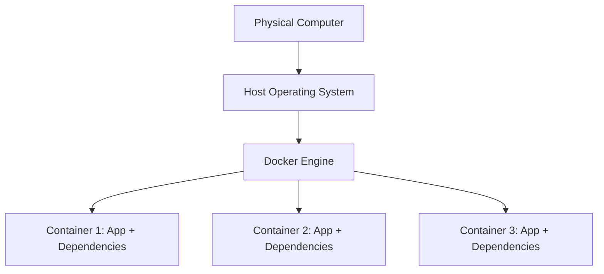
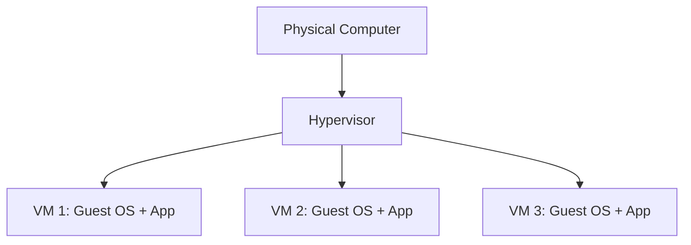
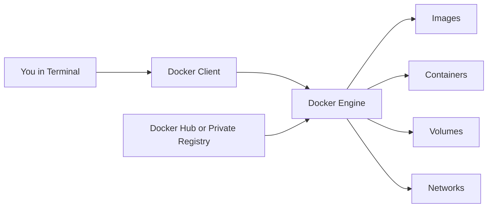

# Introduction to Docker

## Goal

This lesson gives you the first mental model you need for Docker.

By the end of this lesson, you should understand:

- What Docker is
- What problem Docker solves
- The difference between an image and a container
- How Docker differs from a virtual machine

## Pre-requisites

- No prior Docker knowledge is required
- You only need basic comfort reading simple terminal commands

## Before We Start

If you are completely new to Docker, this is the right place to begin.

This lesson assumes you do not already know words like image, container, registry, or volume.
We will go slowly.

The most important rule for this lesson is this:

> Do not try to memorize everything at once. First understand the big idea.

## Flow-0: Understand the Basic Docker Story

### Step-1: Understand the problem Docker solves

Read the sections about:

- The big idea
- Why Docker was created
- Why Docker is used

### Step-2: Understand image vs container

Focus on these two words first:

- Image
- Container

### Step-3: Understand container vs virtual machine

Read the comparison and diagrams.

### Step-4: Review Docker architecture words

Make sure these words feel familiar:

- Docker Client
- Docker Engine
- Docker Image
- Docker Container
- Docker Registry

### Step-5: Review the first command preview

```powershell
docker run hello-world
```

## Expected Result

After this lesson, you should be able to explain Docker in your own words without needing exact textbook definitions.

## The Big Idea

Imagine you build a toy house.
To show it to someone else, you do not want to send them only half the pieces.
You want to send:

- The toy house pieces
- The instructions
- The special tools needed to put it together
- The paint and decorations

That way, the other person can rebuild the same toy house.

Docker works in a similar way.

When developers build software, the software usually depends on many things:

- The application code
- A runtime, such as Python or Node.js
- Installed packages or libraries
- Environment settings
- A command that starts the program

Docker helps package those pieces together in a consistent way.

## What Is Docker?

Docker is a platform that helps you package, ship, and run applications inside containers.

That sentence sounds technical, so let us simplify it.

Docker helps you say:

"Here is my app. Here is everything it needs. Please run it the same way anywhere."

That "package" is usually stored as an image.
When Docker starts that image, it becomes a running container.

## Image and Container in Very Simple Words

These two words confuse beginners more than almost anything else.

### Image

An image is a saved package or blueprint.
It is the prepared thing.
It is not "alive" yet.

You can think of an image like:

- A cake recipe
- A lunch box packed and ready
- A toy set in a sealed box

### Container

A container is what you get when you open and run the image.
It is the living, active version.

You can think of a container like:

- The cake after you bake it
- The lunch after you open and eat it
- The toy after you assemble it and start playing with it

### Short Version

- Image = packaged instructions and files
- Container = running instance of that package

## Why Docker Was Created

Before Docker, developers often had a painful problem:

> "It works on my machine, but not on your machine."

Why does that happen?

Because computers are not all set up the same way.

One computer might have:

- Python 3.12
- The correct library versions
- The right environment variables

Another computer might have:

- Python 3.9
- Missing libraries
- Different settings

So even though the code is the same, the result can be different.

Docker reduces that mismatch by making the application run inside a more predictable environment.

## Why Docker Is Used

Docker is popular because it helps with real everyday work.

### 1. Consistency

If multiple people run the same image, they are much more likely to get the same result.

### 2. Easy sharing

Instead of sending a long list of setup instructions, teams can share an image or a Dockerfile.

### 3. Faster setup

Starting a development environment can become much easier.

### 4. Isolation

An app can run in its own container without mixing all of its dependencies directly into your machine.

### 5. Easier deployment

If an app works in a container locally, it is easier to move that same containerized app to a server or cloud platform.

## A Tiny Story Example

Imagine two developers, Asha and Ben.

Asha builds a Python app that needs:

- Python 3.12
- Flask 3
- A few environment variables

On Asha's computer, the app works.

Ben tries to run the same app, but on Ben's computer:

- Python is older
- Flask is missing
- One setting is wrong

Now Ben sees errors.

If Asha gives Ben a Docker image instead, Ben can run the app in the prepared environment instead of rebuilding the environment from scratch.

That is one of Docker's biggest strengths.

## Containers vs Virtual Machines

People often hear that containers are "like virtual machines." That is partly true, but not fully true.

Both are used to isolate software.
But they work differently.

### Virtual Machine

A virtual machine usually includes:

- A full guest operating system
- Its own system files
- The application running inside it

That makes VMs powerful, but also heavier.

### Container

A container usually includes:

- The application
- Its dependencies
- The files and settings needed to run it

But it does not usually carry a whole separate operating system the same way a VM does.
That is why containers are often lighter and faster to start.

### Easy Analogy

- Virtual machine: a whole separate house
- Container: a room inside a shared building

The room is separate enough for its job, but it still shares the building structure.

### Quick Comparison

| Feature | Container | Virtual Machine |
|---|---|---|
| Starts fast | Usually yes | Usually slower |
| Size | Usually smaller | Usually larger |
| Full guest OS included | Usually no | Yes |
| Resource usage | Lower | Higher |
| Isolation | Good | Often stronger |

### Mermaid Diagram





## Docker Architecture

Now let us look at the main pieces of Docker.

### Docker Client

This is what you use when you type commands like:

```powershell
docker run hello-world
```

The command-line tool is the client.

### Docker Engine

This is the background service that does the real work.
It builds images, starts containers, manages networks, and manages volumes.

### Docker Images

These are the packaged blueprints.
They are used to create containers.

### Docker Containers

These are the running or stopped instances created from images.

### Docker Registry

A registry is a place where images can be stored and shared.

Examples:

- Docker Hub
- GitHub Container Registry
- Azure Container Registry
- Other private registries

### Architecture Diagram



## Important Words You Should Be Comfortable With

### Image

A packaged blueprint used to create containers.

### Container

A running or stopped instance of an image.

### Registry

A storage place for images.

### Volume

A way to keep data safe outside the container's temporary writable layer.

### Network

A communication path that helps containers talk to each other.

### Dockerfile

A text file that contains instructions for building an image.

## Real-World Uses of Docker

Docker is not just for demos. Teams use it in many real situations.

### Local development

Instead of installing a database directly on your laptop, you can run it in Docker.

### Testing

You can spin up a clean environment, run tests, and throw it away.

### CI/CD pipelines

Build servers often use containers to make builds more repeatable.

### Web applications

Apps and their supporting services can be packaged and shipped more easily.

### Microservices

Each service can run in its own container with its own dependencies.

### Learning and demos

Teachers and teams can share runnable examples more easily.

## Your First Docker Command Preview

Later, after installation, you will run:

```powershell
docker run hello-world
```

Let us explain what happens in plain language.

### Step 1

Docker checks whether the `hello-world` image already exists on your machine.

### Step 2

If it does not exist, Docker downloads it.

### Step 3

Docker starts a container from that image.

### Step 4

The container prints a message to the screen.

### Step 5

The container stops because its job is finished.

That tiny demo proves Docker is working.

## Sample Code for This Lesson

This lesson now includes a tiny starter example in `examples/hello-world-demo/`.

Use it when you want the smallest possible hands-on Docker practice.

Files there:

- `run-hello-world.ps1`: runs the classic first Docker demo
- `README.md`: explains what to notice

## What Beginners Usually Get Wrong

### Mistake 1: Thinking image and container mean the same thing

They do not.
An image is the package.
A container is the running instance.

### Mistake 2: Thinking container data always stays forever

Some data disappears when the container is deleted unless you use a volume or a bind mount.

### Mistake 3: Thinking a container should stay alive even if its main process exits

Containers usually live only while their main process is running.

### Mistake 4: Thinking Docker replaces all VMs in every situation

Docker is extremely useful, but VMs still matter in many environments.

## Mini Summary

If you remember only four things from this lesson, remember these:

1. Docker helps package apps so they run more consistently.
2. An image is the packaged blueprint.
3. A container is the running instance of that image.
4. Docker is popular because it makes development, testing, sharing, and deployment easier.

## Quick Quiz

1. What is the difference between an image and a container?
2. Why do developers say, "It works on my machine"?
3. Why are containers usually lighter than virtual machines?
4. What is a registry used for?

## Practice Exercise

Write your answers in your own words:

1. Explain Docker to a friend in two simple sentences.
2. Give one example of a situation where Docker would save setup time.
3. Describe an image using a real-world analogy.
4. Describe a container using a real-world analogy.

## What Comes Next

Continue to [Installing Docker](../02-installation/installation.md).
