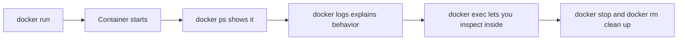

# Docker CLI Basics

## Goal

This lesson teaches you how to talk to Docker from the terminal.

You do not need to become a command-line expert overnight.
You only need to become comfortable with a small set of commands that you will use again and again.

## Why the CLI Matters

Docker Desktop gives you a visual interface, but the command line is still extremely important.

Why?

Because most tutorials, teams, and production workflows use Docker commands directly.

If you understand the CLI, you understand Docker more deeply.

## Pre-requisites

Before starting this lesson, make sure:

- Docker Desktop is installed
- Docker Desktop is running
- `docker version` works
- `docker run hello-world` works

If any of those fail, go back to the installation lesson first.

## The General Command Pattern

Many Docker commands follow a simple pattern:

```powershell
docker <object> <action>
```

Examples:

```powershell
docker image ls
docker container ls
docker volume ls
docker network ls
```

This is a nice mental model because it reads almost like a sentence:

- Docker image list
- Docker container list

Docker also supports older shortcut forms such as:

```powershell
docker images
docker ps
```

Both styles are common.

## The Commands You Should Learn First

Let us focus on the commands that matter most at the beginning.

### `docker version`

```powershell
docker version
```

Use this to check the client and server versions.

### `docker info`

```powershell
docker info
```

Use this to see detailed information about your Docker environment.

### `docker run hello-world`

```powershell
docker run hello-world
```

Use this to test whether Docker can download and run a container.

### `docker ps`

```powershell
docker ps
```

Use this to list running containers.

### `docker ps -a`

```powershell
docker ps -a
```

Use this to list all containers, including stopped ones.

### `docker images`

```powershell
docker images
```

Use this to list downloaded or built images.

### `docker rm`

```powershell
docker rm <container-id-or-name>
```

Use this to remove a stopped container.

### `docker rmi`

```powershell
docker rmi <image-id-or-name>
```

Use this to remove an image.

## Essential Docker Commands Reference

| Command | Meaning |
|---|---|
| `docker ps` | List running containers |
| `docker ps -a` | List all containers, including stopped ones |
| `docker images` | List images on the machine |
| `docker stop <name>` | Stop a running container |
| `docker start <name>` | Start a stopped container |
| `docker restart <name>` | Restart a container |
| `docker logs <name>` | Show container logs |
| `docker exec -it <name> sh` | Open a shell in a running container |
| `docker rm <name>` | Remove a stopped container |
| `docker rmi <image>` | Remove an image |
| `docker inspect <name>` | Show detailed configuration and runtime info |

## Flow-1: Run an Nginx Container and Practice Core Commands

### Step-1: Start the container

```powershell
docker run -d -p 8080:80 --name my-nginx nginx
```

### Step-2: Verify the container is running

```powershell
docker ps
docker ps -a
```

### Step-3: Access the application

Open:

`http://localhost:8080`

Expected result:

- The Nginx welcome page appears

### Step-4: View logs

```powershell
docker logs my-nginx
docker logs -f my-nginx
```

### Step-5: Connect to the container terminal

```powershell
docker exec -it my-nginx sh
```

### Step-6: Stop and start the container

```powershell
docker stop my-nginx
docker start my-nginx
```

### Step-7: Remove the container

```powershell
docker stop my-nginx
docker rm my-nginx
```

## Sample Output

After `docker ps`, you should see a running container row that includes:

- The image name `nginx`
- The container name `my-nginx`
- A port mapping that includes `8080->80`

Example output:

```text
CONTAINER ID   IMAGE   COMMAND                  STATUS          PORTS                  NAMES
123abc456def   nginx   "/docker-entrypoint.…"  Up 15 seconds   0.0.0.0:8080->80/tcp   my-nginx
```

## Visual Map



## Understanding `docker run`

This is one of the most important Docker commands:

```powershell
docker run -d -p 8080:80 --name my-nginx nginx
```

At first it may look dense. Let us unpack it slowly.

### `docker run`

Create and start a container.

### `-d`

Run the container in detached mode.

That means Docker starts it in the background instead of keeping your terminal attached to it.

### `-p 8080:80`

Map port `8080` on your computer to port `80` inside the container.

This is why you can open the app in your browser using your own machine's port.

### `--name my-nginx`

Give the container a human-friendly name.

This is much easier than remembering a random container ID.

### `nginx`

This is the image Docker should use.

## What You Should See

After running the command, open:

`http://localhost:8080`

Expected result:

- The Nginx welcome page appears in your browser

That proves:

- The container is running
- Port mapping works
- Docker can serve traffic from the container to your machine

## Starting, Stopping, and Restarting

```powershell
docker stop my-nginx
docker start my-nginx
docker restart my-nginx
```

These are basic life-cycle commands.

- `stop`: stop the container
- `start`: start an existing stopped container again
- `restart`: stop and start it again

## Viewing Logs

Many applications print useful messages to standard output.

Docker lets you read those messages.

```powershell
docker logs my-nginx
```

Follow logs continuously:

```powershell
docker logs -f my-nginx
```

The `-f` means follow.
It is like saying, "Keep showing me new log lines as they appear."

## Running a Command Inside a Container

Sometimes you want to peek inside a running container.

```powershell
docker exec -it my-nginx sh
```

Breakdown:

- `exec`: run a command inside an existing container
- `-it`: interactive terminal mode
- `sh`: start a shell

This is very useful for learning and debugging.

## Inspecting Docker Objects

```powershell
docker inspect my-nginx
```

This gives detailed JSON information about the container.

You may not understand all of it yet, and that is fine.

Useful things you can often find there include:

- Container settings
- Network information
- Mounted volumes
- Port mappings
- Environment variables

## Cleaning Up

When you finish practicing, clean up your test container.

```powershell
docker stop my-nginx
docker rm my-nginx
```

You can also remove unused Docker data:

```powershell
docker system prune
```

Be careful with that one.
It removes unused containers, networks, and more.

## Sample Code for This Lesson

This lesson includes a practice script in `examples/nginx-cli-demo/practice-cli.ps1`.

That script walks through a small CLI session using Nginx so you can practice:

- Starting a container
- Listing containers
- Reading logs
- Inspecting a container
- Cleaning up afterward

## A Helpful Mental Model

Think of Docker commands in four groups:

1. Build: create images
2. Run: start containers
3. Inspect: check status, logs, and details
4. Clean up: remove what you no longer need

## Common Beginner Mistakes

### Mistake 1: Forgetting `-p`

If the container runs a web app but you did not publish the port, the app may not be reachable from your browser.

### Mistake 2: Thinking `docker ps` shows everything

It shows only running containers.
Use `docker ps -a` to see stopped ones too.

### Mistake 3: Trying `docker exec` on a stopped container

You can only execute commands in a running container.

### Mistake 4: Removing an image that is still used by a container

Docker may block that until the related container is removed.

## Mini Summary

If you learn only a handful of commands well, learn these first:

- `docker run`
- `docker ps`
- `docker ps -a`
- `docker images`
- `docker stop`
- `docker start`
- `docker logs`
- `docker exec`

## Quick Quiz

1. What is the difference between `docker ps` and `docker ps -a`?
2. What does `-d` do in `docker run`?
3. What does `-p 8080:80` do?
4. Why is `--name` helpful?
5. What command lets you open a shell inside a running container?

## Practice Exercise

Run these commands in order and explain each one in your own words:

```powershell
docker run -d -p 8080:80 --name my-nginx nginx
docker ps
docker logs my-nginx
docker exec -it my-nginx sh
docker stop my-nginx
docker rm my-nginx
```

## What Comes Next

Continue to [Images and Containers](../04-images-and-containers/images-and-containers.md).
