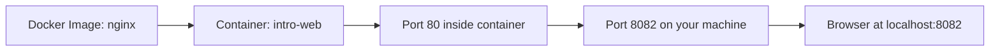

# Images and Containers

## Goal

This lesson focuses on the most important Docker relationship:

- Image
- Container

If you understand these two words deeply, many other Docker topics become easier.

## The Most Important Difference

An image is the prepared package.
A container is the thing running from that package.

You will hear that idea often because it matters a lot.

## Simple Analogy

Let us use a very simple analogy.

- Image: a cookie cutter shape and recipe
- Container: an actual cookie made from it

You can make many cookies from the same cutter and recipe.

In the same way, you can create many containers from one image.

## What Is an Image?

An image is a read-only packaged blueprint.

It usually contains:

- Application files
- Runtime software
- Installed dependencies
- Configuration defaults
- Startup instructions

An image does not "do" anything by itself until you run it.

## What Is a Container?

A container is an instance of an image.

It can be:

- Running
- Stopped
- Restarting
- Removed

The important point is that a container is created from an image.

## Pre-requisites

Before starting this lesson:

- Docker should be installed and running
- You should be comfortable with `docker run`, `docker ps`, and `docker images`

## Flow-1: Pull an Image from Docker Hub and Run It Locally

### Step-1: Pull the image

```powershell
docker pull nginx
```

### Step-2: Verify the image exists locally

```powershell
docker images
```

Expected result:

- You should see `nginx` in the image list

### Step-3: Run the image as a container

```powershell
docker run -d --name intro-web -p 8082:80 nginx
```

### Step-4: Access the application

Open:

`http://localhost:8082`

Expected result:

- The default Nginx page appears

### Step-5: List running and stopped containers

```powershell
docker ps
docker ps -a
```

### Step-6: Connect to the container

```powershell
docker exec -it intro-web sh
```

### Step-7: Stop and remove the container

```powershell
docker stop intro-web
docker rm intro-web
```

### Step-8: Remove the image if needed

```powershell
docker images
docker rmi nginx
```

## Sample Output

After `docker images`, you should see something similar to this:

```text
REPOSITORY   TAG       IMAGE ID       CREATED        SIZE
nginx        latest    abcdef123456   2 weeks ago    187MB
```

After `docker ps`, you should see the running container with the published port:

```text
CONTAINER ID   IMAGE   COMMAND                  STATUS          PORTS                  NAMES
123abc456def   nginx   "/docker-entrypoint.…"  Up 10 seconds   0.0.0.0:8082->80/tcp   intro-web
```

## Visual Map



## Where Images Come From

Images can come from several places.

### Docker Hub

This is the most common public registry for beginners.

### A private registry

Companies often store internal images in private registries.

### Your own Dockerfile

You can build your own image for your own application.

## Example: Run the Official Nginx Image

```powershell
docker run -d -p 8080:80 --name web nginx
```

Let us describe what Docker does.

1. It checks whether the `nginx` image exists locally.
2. If not, it downloads it.
3. It creates a container from that image.
4. It starts the container.
5. It maps your machine's port `8080` to the container's port `80`.

## Listing Images

```powershell
docker images
```

Example output:

```text
REPOSITORY   TAG       IMAGE ID       CREATED       SIZE
nginx        latest    abcdef123456   2 weeks ago   187MB
```

What the columns roughly mean:

- `REPOSITORY`: image name
- `TAG`: version label
- `IMAGE ID`: internal identifier
- `CREATED`: when the image was created
- `SIZE`: approximate image size

## Listing Containers

### Running containers only

```powershell
docker ps
```

### All containers, including stopped ones

```powershell
docker ps -a
```

This difference matters a lot.

Many beginners run `docker ps`, see nothing, and think the container vanished.
Often the container is just stopped, so `docker ps -a` is the better debugging command.

## Pulling an Image Without Running It

```powershell
docker pull alpine
```

This downloads the image only.

That teaches an important distinction:

- `docker pull` gets the image
- `docker run` creates and starts a container from the image

## Running an Interactive Container

```powershell
docker run -it alpine sh
```

This command is useful for learning because it drops you inside a tiny Linux environment.

Try these commands inside the container:

```sh
pwd
ls
cat /etc/os-release
exit
```

What you are learning here:

- The container has its own filesystem view
- You can run shell commands inside it
- Exiting the main shell usually stops the container

## Naming Containers

If you do not provide a name, Docker chooses a random one.

Random names are fine for quick experiments, but named containers are easier to work with.

Example:

```powershell
docker run -d --name lesson-nginx -p 8081:80 nginx
```

Now you can refer to the container as `lesson-nginx`.

## Removing Containers and Images

Remove a stopped container:

```powershell
docker rm lesson-nginx
```

Remove an image:

```powershell
docker rmi alpine
```

Important note:

Docker may not let you remove an image that is still used by an existing container.

## Image Layers

Docker images are usually built in layers.

This is one reason Docker can be efficient.

Layering helps with:

- Faster rebuilds
- Better caching
- Reusing unchanged parts

### Simple Layer Example

A Dockerfile might do this:

1. Start from Python
2. Install dependencies
3. Copy application code
4. Set the startup command

Each step usually creates a layer.

If only the app code changes, Docker may reuse the earlier layers and rebuild faster.

## Hands-On Example

### Step 1: Start an Nginx container

```powershell
docker run -d --name intro-web -p 8082:80 nginx
```

### Step 2: Open the site

Visit `http://localhost:8082`

Expected result:

- You should see the default Nginx page

### Step 3: Inspect what exists now

```powershell
docker images
docker ps
docker logs intro-web
docker inspect intro-web
```

Ask yourself:

- Which command shows the image?
- Which command shows the container?
- Which command shows the app output?

### Step 4: Stop and remove the container

```powershell
docker stop intro-web
docker rm intro-web
```

After removing the container, run:

```powershell
docker images
```

Notice that the image still exists.

That is another important lesson:

- Removing a container does not automatically remove the image

## Example Files

See the example web page in this lesson's `examples/` folder.

## Common Beginner Mistakes

### Mistake 1: Confusing image and container

An image is the package.
A container is an instance created from it.

### Mistake 2: Thinking one image can create only one container

One image can create many containers.

### Mistake 3: Forgetting stopped containers still exist

Use `docker ps -a` when debugging.

### Mistake 4: Removing the wrong thing

Sometimes beginners try to remove an image when what they really meant to remove was the container.

## Mini Summary

Remember these key ideas:

1. Images are packaged blueprints.
2. Containers are running or stopped instances of images.
3. You can create many containers from one image.
4. `docker pull` downloads an image.
5. `docker run` creates and starts a container.

## Quick Quiz

1. What is the difference between `docker pull` and `docker run`?
2. Can one image create more than one container?
3. What command shows all containers, including stopped ones?
4. Why can an image still exist after its container is removed?

## Exercise

1. Pull the `alpine` image.
2. Start it interactively.
3. Run `cat /etc/os-release` inside the container.
4. Exit the shell.
5. Run `docker ps -a`.
6. Remove the stopped container.
7. Confirm whether the image still exists.

## What Comes Next

Continue to [Volumes and Networks](../05-volumes-and-networks/volumes-and-networks.md).
