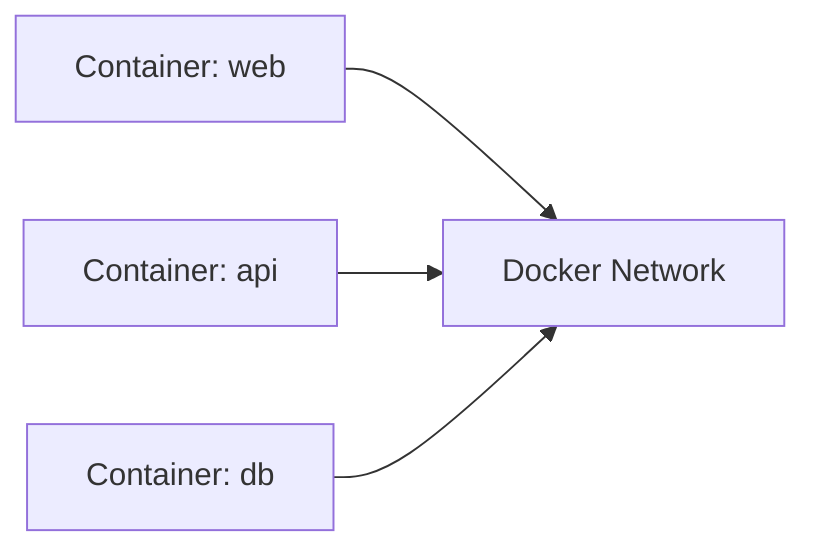

# Volumes and Networks

## Goal of This Lesson

This lesson explains two ideas that make beginners uncomfortable at first:

- Where container data lives
- How containers talk to each other

If those two things feel fuzzy right now, that is normal.
We will break both down slowly.

## First Big Idea: Containers Are Easy to Replace

One reason Docker is useful is that containers are meant to be disposable.

That means:

- You can create them quickly
- Stop them quickly
- Delete them quickly
- Recreate them again from the image

This is powerful, but it creates a new question:

> If the container is easy to delete, what happens to the data inside it?

That is where volumes and bind mounts come in.

## Why Storage Matters

Imagine you write a note on a whiteboard inside a toy box.
If the toy box is thrown away, the whiteboard goes with it.

That is similar to what happens with container-local writable data.

If an application writes important data inside a container and that container is removed, the data may disappear.

That is a problem for things like:

- Databases
- User uploads
- Generated reports
- Application state
- Logs you want to keep

## What Is a Volume?

A volume is a storage area managed by Docker.

Think of it as a safe storage box that lives outside the short life of a single container.

So instead of saving the important files only inside the container, you attach a volume.
Then the container can read and write data there.

If the container is removed, the volume can still remain.

### Why that matters

This means you can:

- Delete and recreate a container
- Keep the important data
- Reconnect the new container to the same stored data

## Create, List, and Inspect a Volume

### Create a volume

```powershell
docker volume create app-data
```

What this does:

- Creates a Docker-managed storage location named `app-data`

### List volumes

```powershell
docker volume ls
```

What you should see:

- A list of Docker volumes
- One of them should be `app-data`

### Inspect a volume

```powershell
docker volume inspect app-data
```

What this does:

- Shows details such as the volume name and where Docker stores it on your machine

## What Is a Bind Mount?

A bind mount is different.

Instead of Docker choosing the storage location, you choose an actual folder from your computer and connect it into the container.

Think of it like opening a window between:

- A folder on your laptop
- A folder inside the container

When the container changes files there, you can often see those changes directly on your machine.

That is why bind mounts are very common in local development.

## Bind Mount vs Named Volume

| Type | What It Uses | Good For | Who Controls the Storage Path |
|---|---|---|---|
| Bind mount | A real folder on your computer | Local development and live editing | You |
| Named volume | Storage managed by Docker | Persistent app data such as databases | Docker |

## Very Simple Rule

Use a bind mount when you want to work with files from your own machine.

Use a named volume when the application needs persistent storage and you do not care about manually choosing the exact host folder.

## Bind Mount Example

```powershell
docker run --rm -v ${PWD}/examples/bind-data:/data alpine sh -c "echo hello > /data/hello.txt"
```

Let us decode that command slowly.

- `docker run`: start a container
- `--rm`: remove it automatically after it finishes
- `-v ${PWD}/examples/bind-data:/data`: connect a folder on your computer to `/data` in the container
- `alpine`: use the tiny Alpine Linux image
- `sh -c "echo hello > /data/hello.txt"`: create a file inside the mounted folder

Expected result:

- The container runs
- It writes a file called `hello.txt`
- The container exits
- The file now exists in your local `examples/bind-data` folder

Important point:

The file remains on your machine even after the container disappears.

## Named Volume Example

```powershell
docker run --rm -v app-data:/data alpine sh -c "echo saved > /data/note.txt"
```

This looks similar, but notice the difference:

- `app-data:/data` uses a Docker volume named `app-data`
- There is no host folder path on the left side

Expected result:

- The container writes `note.txt` into the volume
- The container stops and is removed
- The data still remains in the Docker volume

## Proving the Data Survives

Run a second container and read the file from the same volume:

```powershell
docker run --rm -v app-data:/data alpine sh -c "cat /data/note.txt"
```

Expected output:

```text
saved
```

That is the proof.
The first container is gone, but the data is still there.

## What Is a Docker Network?

Now let us switch from storage to communication.

If you have two containers, such as:

- A web app
- A database

They need a way to talk to each other.

Docker networks provide that communication path.

Think of a Docker network as a private neighborhood road that containers can use to visit one another.

## Why Not Just Use localhost?

This is a very common beginner mistake.

If you are inside one container and you use `localhost`, you are usually pointing back to that same container, not to another container.

So if a web app container needs to talk to a database container, it usually should not use `localhost`.
It should use the other container's name on the shared Docker network.

## Create, List, and Inspect a Network

### Create a custom network

```powershell
docker network create app-net
```

What this does:

- Creates a new Docker bridge network named `app-net`

### List networks

```powershell
docker network ls
```

### Inspect a network

```powershell
docker network inspect app-net
```

Inspection helps you see:

- The network name
- The driver type
- Which containers are attached to it

## Why Custom Networks Help

Custom networks are useful because they make it easier to:

- Connect related containers together
- Separate unrelated applications
- Use container names as hostnames
- Understand which services belong together

## Example: Two Containers on One Network

### Step 1: Create the network

```powershell
docker network create app-net
```

### Step 2: Start a web server on that network

```powershell
docker run -d --name web-a --network app-net nginx
```

What this does:

- Starts an Nginx web server
- Gives it the name `web-a`
- Connects it to the `app-net` network

### Step 3: Start another container and contact `web-a`

```powershell
docker run --rm --network app-net alpine sh -c "apk add --no-cache curl ; curl http://web-a"
```

What this does:

- Starts a temporary Alpine container on the same network
- Installs `curl`
- Sends an HTTP request to `http://web-a`

Expected result:

- The second container reaches the first one by name
- You should see HTML from the default Nginx page

That is the key lesson.
Containers on the same Docker network can often reach each other using container or service names.

## Mermaid Diagram



## Bind Mount or Volume: Which Should I Choose?

Choose a bind mount when:

- You are editing files locally
- You want code changes from your machine to appear quickly in the container
- You are doing development work

Choose a named volume when:

- The app needs persistent data
- You are storing database data
- You want Docker to manage the storage location

## Common Beginner Mistakes

### Mistake 1: Deleting the container and expecting the data to stay

The data only stays if it was stored in a bind mount or volume.

### Mistake 2: Using a broken Windows path in a bind mount

Small path mistakes can cause confusing mount problems.

### Mistake 3: Using `localhost` to reach another container

Inside a container, `localhost` usually means that same container.

### Mistake 4: Forgetting that containers must share a network to talk easily

If two containers are not on the same network, communication becomes harder or may fail.

## Mini Summary

Remember these ideas:

1. Containers are easy to replace.
2. Important data should usually live in a volume or bind mount.
3. Bind mounts connect real folders from your computer.
4. Named volumes are managed by Docker.
5. Networks let containers communicate.
6. On a shared Docker network, containers can often talk to each other by name.

## Hands-On Practice

See the `examples/` folder for:

- A write-to-volume example
- A simple Compose-based network demo

## Quick Quiz

1. Why can data written only inside a container disappear?
2. What is the difference between a bind mount and a named volume?
3. Why should a database usually use persistent storage?
4. Why is `localhost` often wrong when one container tries to reach another?
5. What benefit do custom Docker networks provide?

## Exercise

1. Create a volume named `practice-data`.
2. Run an Alpine container that writes a file into that volume.
3. Run a second Alpine container and read the file from the same volume.
4. Create a network named `practice-net`.
5. Start two containers on that network.
6. Use one container to contact the other by name.
7. Explain in your own words why the communication worked.

## What Comes Next

Continue to [Dockerfiles, Build Context, and .dockerignore](../06-dockerfiles/dockerfiles.md).
