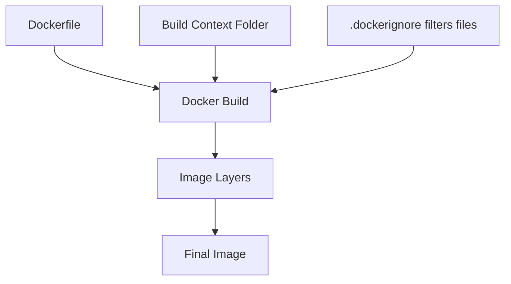

# Dockerfiles, Build Context, and .dockerignore

## Goal of This Lesson

This lesson teaches you one of the most important Docker skills:

> How to create your own image instead of only using images made by other people.

To do that, you need to understand three things clearly:

- What a Dockerfile is
- What Docker can see during a build
- Why `.dockerignore` keeps builds clean and efficient

## What Is a Dockerfile?

A Dockerfile is a recipe for building a Docker image.

If that word "recipe" helps, keep it.
It is a very good beginner mental model.

When you bake a cake, the recipe tells you:

- What ingredients to start with
- What order to use them in
- What steps to perform
- What the final result should be

A Dockerfile does the same kind of job for an image.

It tells Docker things like:

- Which base image to start from
- Where the app files should go
- Which dependencies to install
- Which command should run when the container starts

## A Simple Dockerfile Example

```Dockerfile
FROM python:3.12-slim
WORKDIR /app
COPY requirements.txt .
RUN pip install --no-cache-dir -r requirements.txt
COPY . .
CMD ["python", "app.py"]
```

At first this may look like a strange mini language. Let us decode it line by line.

## Understanding the Example Line by Line

### `FROM python:3.12-slim`

This says:

"Start from an existing image that already has Python installed."

Why use a base image?

Because you usually do not want to build everything from zero.
You want a solid starting point.

### `WORKDIR /app`

This sets the working folder inside the image.

Think of it as saying:

"From now on, do the next steps inside the `/app` folder."

### `COPY requirements.txt .`

This copies `requirements.txt` from your project folder on the host into the current working folder inside the image.

Because the current working folder is `/app`, the file ends up there.

### `RUN pip install --no-cache-dir -r requirements.txt`

This runs a command while building the image.

In plain words:

"Install the Python packages listed in `requirements.txt`."

This happens during the image build, not later when the container starts.

### `COPY . .`

This copies the rest of the project files into the image.

The left `.` means the current folder in your project.
The right `.` means the current working folder inside the image, which is `/app`.

### `CMD ["python", "app.py"]`

This sets the default command used when a container starts from the image.

In plain words:

"When the container runs, start the app with Python."

## Common Dockerfile Instructions

Here are the instructions you will see often.

### `FROM`

Choose the base image.

### `WORKDIR`

Set the folder where the next instructions will run.

### `COPY`

Copy files from your machine into the image.

### `RUN`

Execute a command while building the image.

### `ENV`

Define environment variables inside the image.

### `EXPOSE`

Document the port the application uses.

### `CMD`

Set the default startup command.

### `ENTRYPOINT`

Set the main executable for the container.

## What Happens During `docker build`

Suppose you run this command:

```powershell
docker build -t flask-demo .
```

Let us translate it.

- `docker build`: build an image
- `-t flask-demo`: give the image a tag named `flask-demo`
- `.`: use the current folder as the build context

## What Is Build Context?

Build context is the set of files Docker can access during the build.

This is extremely important.

When you run:

```powershell
docker build -t flask-demo .
```

the final `.` does not just mean "current folder" in a casual way.
It means:

> Send this folder and its contents as the build context Docker can use.

That is why `COPY` works only with files that are inside the build context.

## A Very Common Beginner Confusion

Beginners often think Docker can copy any file from anywhere on the computer during a build.

Usually that is not how it works.

If a file is not in the build context, your Dockerfile generally should not expect to copy it.

That is why choosing the correct build folder matters.

## Why Order Matters in a Dockerfile

Docker builds images in layers.

Each instruction usually creates a new layer.

That means order affects caching.

For example, this is smart:

1. Copy `requirements.txt`
2. Install dependencies
3. Copy the rest of the app code

Why?

Because if only your app code changes, Docker may be able to reuse the already-built dependency layer and rebuild faster.

## What Is `.dockerignore`?

`.dockerignore` is a file that tells Docker which files and folders should not be sent as part of the build context.

Think of it like packing a suitcase.
If you are going on a short trip, you do not pack every object in your house.

In the same way, Docker does not need everything from your repository.

## Why `.dockerignore` Matters

Without `.dockerignore`, you might accidentally send:

- `.git` history
- local cache folders
- test artifacts
- secrets such as `.env`
- huge folders like `node_modules`

That causes problems such as:

- Slower builds
- Larger contexts
- More network transfer to the Docker engine
- Increased security risk

## Common `.dockerignore` Entries

- `.git`
- `node_modules`
- `__pycache__`
- `.env`
- build output folders
- temporary files

## Example Application in This Lesson

This lesson includes a small Flask web app in `examples/python-flask-app/`.

The example is intentionally simple so you can focus on the Docker concepts.

## Step-by-Step: Build and Run the Example

Open a terminal in the example folder and run:

```powershell
docker build -t flask-demo .
docker run -d -p 5000:5000 --name flask-demo-app flask-demo
```

### What the first command does

- Reads the Dockerfile
- Sends the build context
- Builds the image layer by layer
- Creates an image tagged as `flask-demo`

### What the second command does

- Starts a container from `flask-demo`
- Runs it in the background because of `-d`
- Maps port `5000` on your computer to port `5000` inside the container
- Names the container `flask-demo-app`

## What You Should See

Open `http://localhost:5000`

Expected result:

- The Flask application responds with a simple message or JSON output

You can also check:

```powershell
docker ps
docker logs flask-demo-app
```

## Mermaid Build Diagram



## Common Beginner Mistakes

### Mistake 1: Running `docker build` from the wrong folder

If you build from the wrong place, the files Docker needs may not be in the context.

### Mistake 2: Copying the whole project too early

That can reduce cache efficiency.

### Mistake 3: Copying secrets into the image

Do not bake secrets into images unless you explicitly understand the consequences.

### Mistake 4: Forgetting `.dockerignore`

This often makes builds slower and less safe.

### Mistake 5: Confusing `RUN` with `CMD`

`RUN` happens during image build.
`CMD` is used later when a container starts.

## Mini Summary

If you remember only the core ideas, remember these:

1. A Dockerfile is a recipe for building an image.
2. Docker builds images step by step.
3. The build context is the set of files Docker can access.
4. `.dockerignore` keeps unwanted files out of the build context.
5. Dockerfile instruction order matters for caching and efficiency.

## Quick Quiz

1. What is a Dockerfile?
2. What does the final `.` mean in `docker build -t app .`?
3. Why is `.dockerignore` important?
4. What is the difference between `RUN` and `CMD`?
5. Why do many Dockerfiles copy dependency files before the full source code?

## Exercise

1. Build the Flask example image.
2. Run the container.
3. Visit the app in the browser.
4. Change the app code.
5. Build again.
6. Run the new version.
7. Observe which build steps seem to be cached and which ones rerun.

## What Comes Next

Continue to [Environment Variables, CMD, and ENTRYPOINT](../07-environment-and-startup/environment-and-startup.md).
