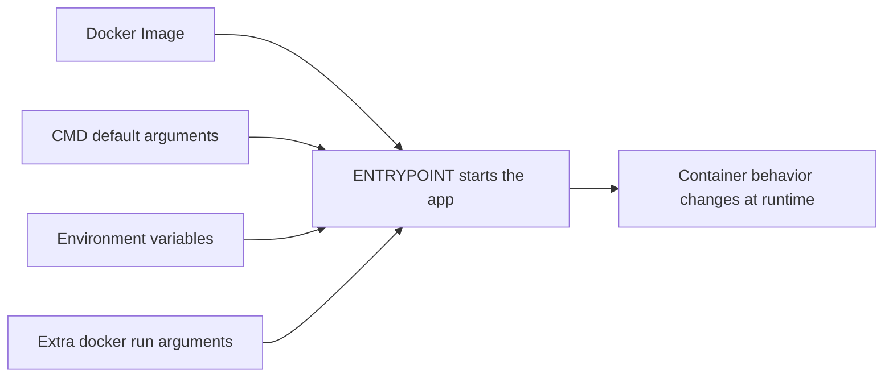

# Environment Variables, CMD, and ENTRYPOINT

## Goal

This lesson answers a very practical beginner question:

> How do I change container behavior without rewriting the app every time?

To answer that, we need to understand:

- Environment variables
- `CMD`
- `ENTRYPOINT`

These ideas control how a container starts and how it is configured.

## Pre-requisites

- Docker Desktop running
- Basic understanding of Dockerfiles and containers

## Flow-1: Build an Image and Override Its Behavior

### Step-1: Build the example image

```powershell
docker build -t env-demo .
```

### Step-2: Run the image with default values

```powershell
docker run --rm env-demo
```

### Step-3: Run the image with custom environment variables and arguments

```powershell
docker run --rm -e APP_NAME=CourseApp env-demo --mode production
```

## Sample Output

The application output should show:

- The application name
- The application environment
- The selected mode

Those values should change when you pass new environment variables or arguments.

For example, a default run may look like this:

```text
APP_NAME=DemoApp
APP_ENV=development
MODE=demo
```

An overridden run may look like this:

```text
APP_NAME=CourseApp
APP_ENV=development
MODE=production
```

## Visual Map



## Why Configuration Matters

Imagine you have the same application in three places:

- Your laptop
- A test server
- A production server

The app might need different settings in each place.

For example:

- Different database host
- Different port
- Different logging level
- Different mode such as development or production

It would be a bad idea to hard-code all of those differences directly into the source code every time.

Instead, we often pass configuration from outside.

## Environment Variables in Simple Words

An environment variable is a named value given to a program when it runs.

It is like placing a small note next to the app that says:

- "Your app name is DemoApp"
- "You are running in development mode"
- "Use this database host"

The app reads those values at runtime.

## Why Environment Variables Are Useful

They help you:

- Reuse the same image in different environments
- Avoid rewriting code for small config changes
- Separate configuration from application logic

Examples of values often passed this way:

- App mode
- Port number
- Database host
- Feature flags
- API endpoints

## Pass Environment Variables with `docker run`

```powershell
docker run --rm -e APP_NAME=DemoApp -e APP_ENV=development env-demo
```

Breakdown:

- `--rm`: remove the container after it finishes
- `-e APP_NAME=DemoApp`: set the environment variable `APP_NAME`
- `-e APP_ENV=development`: set the environment variable `APP_ENV`
- `env-demo`: use the `env-demo` image

## What Is `CMD`?

`CMD` sets the default command a container should run.

Example:

```Dockerfile
CMD ["python", "app.py"]
```

That means:

"If the user does not provide another command, start the app this way."

## What Is `ENTRYPOINT`?

`ENTRYPOINT` sets the main executable.

Example:

```Dockerfile
ENTRYPOINT ["python", "app.py"]
```

That means the container is strongly centered around that executable.

## The Difference in Plain Language

Here is the simplest rule that usually helps beginners.

### `CMD`

Use `CMD` when you want a default command that can be replaced.

### `ENTRYPOINT`

Use `ENTRYPOINT` when you want the container to behave like a fixed program.

## Using Both Together

This is a common and useful pattern:

```Dockerfile
ENTRYPOINT ["python", "app.py"]
CMD ["--mode", "demo"]
```

In plain words, this says:

- Always run `python app.py`
- If no extra arguments are provided, use `--mode demo`

Docker combines them at startup.

## Example Scenario

Suppose your app behaves like this:

- The executable is always the same
- But the mode changes sometimes

Then this pattern makes sense:

- `ENTRYPOINT` = the app itself
- `CMD` = the default options for that app

## When to Use Each

Use `CMD` when:

- You want an easy default command
- You want users to override it easily

Use `ENTRYPOINT` when:

- The container should always run one main program

Use both when:

- The program stays the same
- But its default arguments should still be changeable

## Example App in This Lesson

This lesson includes a small Python example that:

- Prints environment variable values
- Prints the selected mode argument

That makes it a good demo for seeing what changes when you pass different values.

## What the Example Commands Mean

### Build the image

```powershell
docker build -t env-demo .
```

### Run it with defaults

```powershell
docker run --rm env-demo
```

Expected idea:

- The image uses its built-in defaults
- The app prints the default app name or environment
- The app prints the default mode from `CMD`

### Override values

```powershell
docker run --rm -e APP_NAME=CourseApp env-demo --mode production
```

Expected idea:

- `APP_NAME` changes because you passed a new environment variable
- The mode changes because you passed a new argument

This is the whole lesson in action.
The same image behaves differently based on runtime configuration.

## Common Beginner Mistakes

### Mistake 1: Storing secrets directly in the image

Be careful with passwords, tokens, and API keys.

### Mistake 2: Confusing `RUN` and `CMD`

`RUN` happens during build.
`CMD` is used when the container starts.

### Mistake 3: Thinking `CMD` and `ENTRYPOINT` are enemies

They are often used together.

### Mistake 4: Putting environment-specific values directly in the code when a variable would be cleaner

## Mini Summary

Remember these points:

1. Environment variables let you change configuration without changing code.
2. `CMD` sets a default command.
3. `ENTRYPOINT` sets the main executable.
4. Using both together is common when you want a fixed program and changeable default arguments.

## Quick Quiz

1. Why are environment variables useful?
2. What is the main job of `CMD`?
3. What is the main job of `ENTRYPOINT`?
4. When would you use both together?
5. What is one danger of putting secrets directly into an image?

## Exercise

1. Build the example image.
2. Run it once with defaults.
3. Run it again with a custom `APP_NAME` value.
4. Run it again with a different mode argument.
5. Explain which values came from environment variables and which came from startup arguments.

## What Comes Next

Continue to [Docker Compose and Multi-Container Apps](../08-docker-compose/docker-compose.md).
