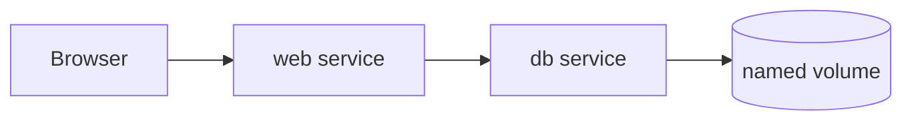

# Docker Compose and Multi-Container Apps

## Goal

This lesson answers another important beginner question:

> What do I do when my application needs more than one container?

That is what Docker Compose is for.

You will learn:

- What Compose is
- Why it is easier than many long `docker run` commands
- How services work together
- How networks, volumes, and environment variables fit into a Compose file

## Pre-requisites

Before starting this lesson:

- Docker should be installed and running
- You should understand images, containers, ports, and environment variables
- You should be comfortable starting one container with `docker run`

## Why One Container Is Often Not Enough

Many real applications need multiple parts.

For example:

- A web app
- A database
- A cache
- An admin tool

You could start each part with a separate `docker run` command.

But that quickly becomes messy.

You would have to remember:

- Ports
- Networks
- Volumes
- Environment variables
- Startup order

That is a lot for a human to manage manually.

## What Is Docker Compose?

Docker Compose lets you describe a multi-container application in one YAML file, usually named `compose.yaml`.

Instead of manually starting each container one by one, you write down the whole setup.

Then Docker Compose reads the file and starts the services for you.

## Think of Compose Like a Cast List

Imagine a school play.

You do not want to remember each actor separately every time.
You want one script that says:

- Who is in the play
- What role each one has
- How they connect
- What props they need

Compose is similar.
It describes the whole application in one place.

## Basic Compose Example

```yaml
services:
  web:
    image: nginx:alpine
    ports:
      - "8080:80"
```

This says:

- Create a service named `web`
- Use the `nginx:alpine` image
- Map port `8080` on your machine to port `80` in the container

## Start and Stop a Compose Project

Start it:

```powershell
docker compose up -d
```

Stop and remove it:

```powershell
docker compose down
```

### What `up -d` means

- `up`: create and start services
- `-d`: run them in the background

### What `down` means

- Stop the services
- Remove the containers and default network created for the project

## Common Compose Concepts

### `services`

These are the application parts, usually one container each.

### `ports`

These publish ports from the container to your machine.

### `volumes`

These provide persistent storage.

### `networks`

These let services talk to each other.

### `environment`

These pass configuration values into services.

### `depends_on`

This expresses startup dependency relationships, but it does not automatically guarantee full readiness.

## Multi-Container Example in This Lesson

This lesson includes a Flask app and PostgreSQL database in `examples/web-db-compose/`.

This is an excellent beginner example because it shows a very common real setup:

- One app container
- One database container

## Flow-3: Run a Multi-Container Application with Docker Compose

### Step-1: Review the Compose file

Before running anything, open `compose.yaml` and identify:

- The `web` service
- The `db` service
- Port mappings
- Environment variables
- The named volume

### Step-2: Start the stack

```powershell
docker compose up --build -d
```

### Step-3: Verify the services are running

```powershell
docker compose ps
```

Expected result:

- A running `web` service
- A running `db` service

### Step-4: Access the application

Open:

`http://localhost:5001`

Expected result:

- You should see JSON from the Flask app

### Step-5: Review logs

```powershell
docker compose logs -f
```

### Step-6: Stop and remove the stack

```powershell
docker compose down
```

## Sample Output

When the example works correctly, the browser should show a JSON response that confirms:

- The Flask app started
- The app can talk to PostgreSQL
- Compose networking is working correctly

Example response:

```json
{
  "message": "Web service is running",
  "database": "connected"
}
```

## What the Start Command Means

```powershell
docker compose up --build -d
```

Let us decode it.

- `docker compose up`: start the services defined in `compose.yaml`
- `--build`: rebuild images if needed before starting
- `-d`: run in the background

## What Should Happen

Compose should:

1. Read `compose.yaml`
2. Build the web image if needed
3. Pull the PostgreSQL image if needed
4. Create a network for the project
5. Create containers for `web` and `db`
6. Start them

## Check It in the Browser

Open:

`http://localhost:5001`

Expected result:

- You should see JSON from the Flask app
- The app should be able to talk to PostgreSQL

## Why the App Can Reach the Database

Compose usually creates a shared project network automatically.

That means one service can often reach another service by its service name.

So the web app can use:

- `db`

as the database host name.

That is cleaner than hard-coding a changing IP address.

## Viewing Logs

```powershell
docker compose logs -f
```

This is very useful when something does not work.

You can watch logs from all services together.

## Stop the Stack

```powershell
docker compose down
```

This stops the project and removes the containers and default project network.

## Mermaid Diagram



## Why Service Names Matter

Inside a Compose project, services can usually reach each other by service name.

For example, if your database service is named `db`, your app often uses `db` as the hostname.

That is one of the nicest things about Compose.

## Common Beginner Mistakes

### Mistake 1: Using `localhost` between services

Inside a container, `localhost` usually points back to that same container.
Use the service name instead.

### Mistake 2: Forgetting to publish ports

If you do not publish the needed port, the service may run but still not be reachable from your browser.

### Mistake 3: Expecting `depends_on` to guarantee readiness

It helps express order, but it does not fully solve waiting for an app or database to be ready for traffic.

### Mistake 4: Forgetting `--build` after changing a Dockerfile

If the image definition changed, rebuild when needed.

## Mini Summary

Remember these ideas:

1. Compose manages multi-container apps.
2. A `compose.yaml` file describes the whole application.
3. Services on the same Compose project can usually talk by service name.
4. `docker compose up -d` starts the stack.
5. `docker compose down` stops and removes the stack resources it created.

## Quick Quiz

1. Why is Compose easier than many long `docker run` commands?
2. What does `docker compose up -d` do?
3. What hostname should one service usually use to reach another service in the same Compose project?
4. Why can `localhost` be wrong inside a container?
5. What does `docker compose down` do?

## Exercise

1. Start the lesson example.
2. Read the `compose.yaml` file line by line.
3. Identify the services, ports, environment variables, and volume.
4. Open the app in your browser.
5. Watch the logs.
6. Stop the stack.
7. Start it again without rebuilding.

## What Comes Next

Continue to [Operations](../09-operations/operations.md).
