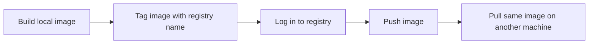

# Docker Hub and Private Registries

## Goal

This lesson explains how images move from one place to another.

You already know how to build and run images locally.
Now you need to know how teams share them.

That is the job of a registry.

## Pre-requisites

- Docker Desktop running
- A Docker Hub account if you want to push images
- Basic comfort with image build and tag commands

## Beginner Path in This Lesson

If registries feel abstract, use this order:

1. Build one small local image.
2. Tag it with a registry name.
3. Understand what changed in `docker images`.
4. Only then think about push, pull, and private registries.

## Flow-1: Build, Tag, and Push an Image

### Step-1: Build a local image

```powershell
docker build -t registry-demo ./examples/tagging-demo
```

### Step-2: Tag the image for a registry

```powershell
docker tag registry-demo your-dockerhub-name/registry-demo:1.0.0
```

### Step-3: Log in to Docker Hub

```powershell
docker login
```

### Step-4: Push the image

```powershell
docker push your-dockerhub-name/registry-demo:1.0.0
```

## Sample Output

- `docker images` should show both the local image name and the fully tagged image name
- After a successful push, the image should appear in your registry account

Example local image listing after tagging:

```text
REPOSITORY                        TAG      IMAGE ID       CREATED          SIZE
registry-demo                     latest   abcdef123456   10 seconds ago   15MB
your-dockerhub-name/registry-demo 1.0.0    abcdef123456   10 seconds ago   15MB
```

## Visual Map



## What Is a Registry?

A registry is a storage place for Docker images.

It is similar to a package warehouse.

You can:

- Push images to it
- Pull images from it
- Share images across machines, teammates, and environments

Without registries, sharing images would be much harder.

## Docker Hub

Docker Hub is the most common public registry beginners use.

Many official images live there, including:

- `nginx`
- `python`
- `postgres`
- `redis`

When you type a command like:

```powershell
docker run nginx
```

Docker often pulls that image from Docker Hub if it is not already on your machine.

## Logging In

If you want to push your own image to Docker Hub, you usually log in first.

```powershell
docker login
```

Docker then asks for credentials such as:

- Username
- Password or access token

## Why Tagging Matters

Before you push an image, you need to tag it correctly.

Tagging tells Docker where the image belongs and what name and version it should use.

## Tagging an Image

Example:

```powershell
docker tag flask-demo your-dockerhub-name/flask-demo:1.0
```

Let us decode that.

- `flask-demo`: the local image you already have
- `your-dockerhub-name/flask-demo:1.0`: the new full name and version for pushing

## Pushing an Image

```powershell
docker push your-dockerhub-name/flask-demo:1.0
```

This uploads the tagged image to the registry.

## Pulling an Image

```powershell
docker pull your-dockerhub-name/flask-demo:1.0
```

This downloads the image from the registry to your machine.

## Sample Code for This Lesson

This lesson includes a safe practice example in `examples/tagging-demo/`.

That folder contains:

- A tiny Dockerfile-based web image
- A small HTML page to package into the image
- `push-template.ps1`, which shows how to build and tag the image before pushing

This is useful because it lets you practice tagging without needing a large application.

## Private Registries

Public registries are useful, but many organizations use private ones.

Why?

Because they often need:

- Access control
- Internal-only images
- Compliance rules
- Better integration with their cloud platform

Examples include:

- GitHub Container Registry
- Azure Container Registry
- Amazon ECR
- Google Artifact Registry
- Self-hosted registries

## Why Tags Should Be Clear

Good tags help people know exactly what they are running.

Examples:

- `1.0.0`
- `1.0.1`
- `2026-05-17`
- `staging`
- `prod`

## Why `latest` Can Be Risky

`latest` sounds convenient, but it can be vague.

If a team says, "We deployed `latest`," that may not clearly tell everyone which build was actually used.

That is why versioned tags are usually better for repeatable deployments.

## Common Beginner Mistakes

### Mistake 1: Forgetting to log in before pushing

If you are not logged in, the push will usually fail.

### Mistake 2: Tagging the wrong image name

A small naming mistake can make Docker push to the wrong place or fail completely.

### Mistake 3: Using only `latest`

That makes it harder to know exactly what version is deployed.

### Mistake 4: Pushing things that should not be shared

Be careful not to push images that accidentally contain secrets or development-only data.

## Mini Summary

Remember these ideas:

1. A registry stores Docker images.
2. Docker Hub is the most common public registry.
3. Tagging tells Docker how to name and version an image.
4. `docker push` uploads an image.
5. Private registries are common in organizations.

## Quick Quiz

1. What is a Docker registry?
2. Why do teams use private registries?
3. Why can `latest` be risky in production?
4. What command uploads an image to a registry?
5. Why is tagging important before pushing?

## Exercise

1. Build one sample image from this repository.
2. Write the tag command you would use for a versioned release.
3. Write the push command you would use.
4. Explain why a version tag is clearer than only using `latest`.

## What Comes Next

Continue to [Best Practices](../12-best-practices/best-practices.md).
