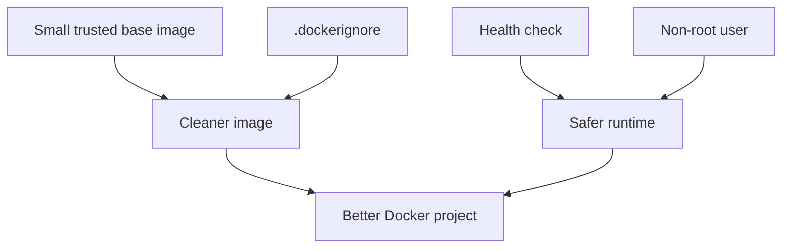

# Best Practices

## Goal

By this point, you have learned many Docker features.

This lesson ties them together into good habits.

Think of best practices as the difference between:

- "I made it work once"
- "I can build this in a clean, repeatable, team-friendly way"

## Pre-requisites

- Docker Desktop running
- Familiarity with images, containers, Dockerfiles, volumes, networks, and Compose

## Flow-1: Review a Small Example That Uses Multiple Best Practices

### Step-1: Open the example folder

Review `examples/good-python-service/`

### Step-2: Start the example

```powershell
docker compose -f examples/good-python-service/compose.yaml up --build -d
```

### Step-3: Open the application

Open `http://localhost:8010`

### Step-4: Check the health endpoint

Open `http://localhost:8010/health`

### Step-5: Stop the example

```powershell
docker compose -f examples/good-python-service/compose.yaml down
```

## Sample Output

- The app should return JSON from the main endpoint
- The health endpoint should return a healthy response
- The example should demonstrate multiple best practices together in one place

Example main endpoint response:

```json
{
	"service": "good-python-service",
	"environment": "development",
	"message": "Service is running"
}
```

## Visual Map



## Why Best Practices Matter

When you first learn Docker, it is normal to focus only on getting a container to run.

But in real projects, people also care about:

- Clarity
- Repeatability
- Safety
- Maintainability
- Team collaboration

Best practices help with all of that.

## Build and Image Practices

### Use small, trusted base images

Start from images you trust, and prefer not to carry unnecessary weight.

### Pin versions when it makes sense

Version pinning can make builds more predictable.

### Add a `.dockerignore` file

Do not send junk into the build context.

### Order Dockerfile steps carefully

Good ordering improves build cache reuse.

### Use multi-stage builds when helpful

They often produce cleaner runtime images.

### Keep images focused

Avoid one giant image that tries to do too many different jobs.

## Runtime Practices

### Use environment variables for configuration

This keeps images reusable across environments.

### Log to standard output and standard error

That makes logs easier for Docker and other tools to collect.

### Run as a non-root user when practical

This reduces risk.

### Add health checks for important services

That helps detect broken-but-still-running containers.

### Set resource limits where appropriate

This helps prevent noisy containers from harming the host or neighbors.

## Data Practices

### Use volumes for persistent data

Important app data should not depend only on a short-lived container filesystem.

### Back up important volumes

If the data matters, back it up.

### Do not assume container files survive deletion

That assumption causes painful surprises.

## Networking Practices

### Use Compose or clear network design

Do not leave service communication to guesswork.

### Use service names instead of hard-coded IP addresses

Names are more stable and easier to understand.

### Expose only the ports you need

If a port does not need to be public, do not publish it unnecessarily.

## Security Practices

### Do not store secrets in images

Treat secrets carefully.

### Keep dependencies updated

Old dependencies can create risk.

### Use least privilege

Give apps only the permissions they need.

### Review images and dependencies regularly

Good Docker hygiene is not a one-time task.

## Team Practices

### Use clear image names and tags

Make it obvious what people are running.

### Keep Compose files readable

A readable Compose file is much easier to maintain.

### Document start, stop, and troubleshooting steps

Future you and other teammates will be grateful.

### Make examples reproducible

If another person cannot follow your README and get the same result, the setup needs improvement.

## Sample Code for This Lesson

This lesson includes a complete example in `examples/good-python-service/`.

That sample puts several best practices together in one small project:

- Clean `.dockerignore`
- Dependency-first Dockerfile ordering
- Environment variables
- A health check
- A non-root runtime user
- A Compose file for easy startup

If you want to see what "good Docker habits together" looks like, start there.

## A Good Beginner Workflow

Here is a practical workflow to follow:

1. Start with a simple app
2. Write a Dockerfile
3. Build the image
4. Run the container
5. Add a volume if data must survive
6. Add Compose if multiple services are needed
7. Add logs and health checks
8. Improve security and image size
9. Document how to use it

## Common Anti-Patterns

These are habits to avoid.

### One huge container doing too many jobs

This becomes hard to maintain.

### Hard-coded secrets

This is risky and hard to manage safely.

### Giant build contexts

They slow things down and can leak unnecessary files.

### No documentation

If only one person knows how to run the app, the setup is fragile.

### No cleanup strategy

Unused containers and images can pile up.

### No versioning strategy

If tags are unclear, deployments become harder to track.

## Mini Summary

Best practices are really about building habits that make Docker:

- Easier to understand
- Easier to repeat
- Safer to run
- Easier to share with a team

## Quick Quiz

1. Why should apps log to standard output?
2. Why is a `.dockerignore` file important?
3. When should you use a volume?
4. Why avoid hard-coded IP addresses?
5. Why is documentation part of Docker best practices?

## Exercise

Pick one example from this repository and answer:

1. What is one thing it does well?
2. What is one production improvement you could add?
3. Which best practices from this lesson already appear in it?
4. Which best practice is still missing?

## What Comes Next

Continue to [Final Projects](../13-final-projects/final-projects.md).
