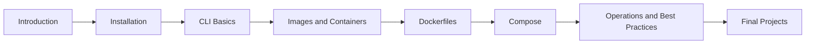

# Docker Course for Beginners

## Goal

This repository is a complete beginner-friendly Docker course.

It is designed for learners who may have no prior Docker knowledge.

The course uses a practical learning style:

1. Learn one topic at a time
2. Follow numbered steps in order
3. Run commands exactly as shown
4. Compare results with expected output
5. Practice using worksheets, answers, examples, and final projects

## What Is Covered in This Repository?

1. Docker Introduction
2. Docker Installation
3. Docker CLI Basics
4. Images and Containers
5. Volumes and Networks
6. Dockerfiles, Build Context, and `.dockerignore`
7. Environment Variables, `CMD`, and `ENTRYPOINT`
8. Docker Compose and Multi-Container Applications
9. Operations: Health Checks, Logging, Limits, Backup, Restore, and Troubleshooting
10. Security, Multi-Stage Builds, and Image Optimization
11. Docker Hub and Private Registries
12. Best Practices
13. Final Projects

## Pre-requisites

- A Windows computer
- Docker Desktop installed
- A code editor such as VS Code
- Basic comfort using PowerShell or Command Prompt

## Flow

### Step-1: Start with the course index

Open [index.md](./index.md)

### Step-2: Read lessons in order

The lesson numbering matters.
Later lessons build on earlier ones.

### Step-3: Run all commands yourself

Do not only read the commands.
Type and run them.

### Step-4: Use the example folders

Many lessons contain runnable examples in an `examples/` folder.

### Step-5: Complete the worksheet before opening the answer key

Each lesson includes:

- `worksheet.md`
- `answers.md`

### Step-6: Finish with the final projects

The final projects are where the ideas come together.

## Start Here If You Feel Lost

If you are a complete beginner, do only these first:

1. Read [01-introduction/introduction.md](./01-introduction/introduction.md).
2. Complete [02-installation/installation.md](./02-installation/installation.md).
3. Run the example in [02-installation/examples/verification/README.md](./02-installation/examples/verification/README.md).
4. Practice [03-docker-cli-basics/docker-cli-basics.md](./03-docker-cli-basics/docker-cli-basics.md).
5. Only then continue to images, Dockerfiles, and Compose.

## Course Map

## Repository Layout

- `index.md`: table of contents
- Numbered lesson folders: one topic per folder
- `final-projects/`: larger hands-on projects

## What You Will See in Most Lessons

- Beginner-friendly explanation
- Pre-requisites
- Numbered step flow
- Commands to run
- Expected output or expected result
- Practice example
- Worksheet and answer key

## Recommended Study Pattern

1. Read the lesson
2. Run the commands
3. Open the example README
4. Compare with expected output
5. Complete the worksheet
6. Check your answers

## Next Step

Start with [index.md](./index.md)
